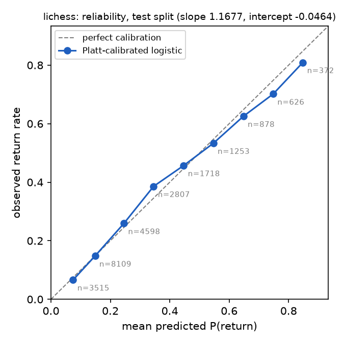
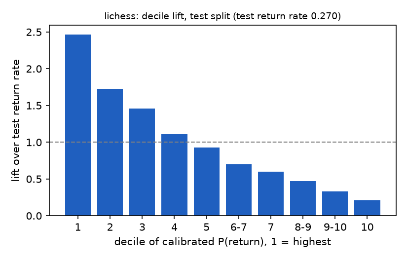

# Results: day-one return on Lichess

Pengjun Lu, 2026-11-08. Every number below is read from `results/lichess/results.json`, produced by `./run.sh` on the 18 monthly files whose SHA-256 values are recorded in `datasets/lichess/download.py`. All result-table cells hold at least 10 returning and 10 non-returning players. Dataset-specific definitions are in `ALGORITHM.md`, section "Lichess".

## Population

| | |
| --- | --- |
| Rated games parsed | 8,249,295 (2013-01 to 2014-06) |
| Player-games after dropping correspondence and self-play | 16,453,148 |
| New accounts (first game rated 1500, rating change ≥ 50, first seen 2013-04-01 to 2014-05-31) | 118,266 |
| Excluded, next day not observed | 0 |
| Eligible | 118,266 |
| Returned on day 1 | 34,811 (29.4%) |

Return rate by cohort year: 2013 31.9% (58,568), 2014 27.0% (59,698).

| Part | Cohort dates | Rows | Return rate |
| --- | --- | ---: | ---: |
| train | 2013-04-01 to 2014-02-01, 307 dates | 70,927 | 31.3% |
| validation | 2014-02-02 to 2014-04-01, 59 dates | 23,463 | 26.4% |
| test | 2014-04-02 to 2014-05-31, 60 dates | 23,876 | 27.0% |

## Models, test split

| Model | PR-AUC | ROC-AUC | Brier |
| --- | ---: | ---: | ---: |
| Majority class (everyone churns) | 0.2701 (floor) | 0.500 | 0.1990 |
| Session minutes, single feature | 0.5093, 1.89x floor | 0.735 | 0.1702 |
| Logistic regression, L2 | 0.5441, 2.01x floor | 0.755 | 0.1644 |
| Logistic regression, Platt-calibrated | 0.5441, 2.01x floor | 0.755 | 0.1638 |

Majority-class accuracy is 0.730; the calibrated model at its threshold reaches 0.685.

## Calibration

Platt slope 1.168, intercept −0.046, fit on validation. Brier moves from 0.1644 to 0.1638, so here calibration fit on validation improves test. The validation and test return rates are close, 26.4% and 27.0%, unlike WoWAH, where they were 30.9% and 20.7% and Platt scaling slightly hurt.

Each row groups test players by their calibrated predicted probability $\hat p$; *Mean predicted* is that group's average $\hat p$ and *Observed* is the fraction that actually returned, so the two columns match when the model is calibrated.

| Bin | Players | Mean predicted | Observed |
| --- | ---: | ---: | ---: |
| 0.0-0.1 | 3,515 | 0.075 | 0.066 |
| 0.1-0.2 | 8,109 | 0.149 | 0.148 |
| 0.2-0.3 | 4,598 | 0.246 | 0.259 |
| 0.3-0.4 | 2,807 | 0.346 | 0.386 |
| 0.4-0.5 | 1,718 | 0.447 | 0.457 |
| 0.5-0.6 | 1,253 | 0.547 | 0.533 |
| 0.6-0.7 | 878 | 0.648 | 0.625 |
| 0.7-0.8 | 626 | 0.748 | 0.701 |
| 0.8-1.0 | 372 | 0.848 | 0.809 |

## Threshold

Threshold, chosen on validation to maximize F1: 0.239. On test: precision 0.447, recall 0.699, F1 0.545; TP 4,509, FP 5,587, FN 1,940, TN 11,840.

## Decile lift

Test players are ranked by $\hat p$ and split into ten equal groups, decile 1 holding the highest scores; *Return rate* is the fraction of each group that actually returned, and *Lift* is that rate divided by the test return rate of 0.270.

| Deciles | Players | Return rate | Lift |
| --- | ---: | ---: | ---: |
| 1 | 2,387 | 0.666 | 2.47 |
| 2 | 2,388 | 0.467 | 1.73 |
| 3 | 2,387 | 0.394 | 1.46 |
| 4 | 2,388 | 0.299 | 1.11 |
| 5 | 2,388 | 0.250 | 0.93 |
| 6-7 | 2,390 | 0.189 | 0.70 |
| 7 | 2,385 | 0.162 | 0.60 |
| 8-9 | 2,446 | 0.128 | 0.47 |
| 9-10 | 2,383 | 0.089 | 0.33 |
| 10 | 2,334 | 0.057 | 0.21 |

Unlike WoWAH, the return rate falls steadily to the bottom decile: first-day chess activity separates low-engagement players too.

## Coefficients

Fitted values: sessions 0.36, session_minutes 0.59, games −0.36, wins 0.41, speeds 0.09; $b = -0.89$.

`games` correlates with `wins` (0.84) and with `session_minutes` (0.79) after the transform. With wins held fixed, more games means more losses, so the negative weight on `games` can be read as: losing on the first day lowers the chance of return.

## Leakage and sensitivity

| Run | Change | Eligible players | Return rate | PR-AUC | Floor | PR-AUC / floor | ROC-AUC |
| --- | --- | ---: | ---: | ---: | ---: | ---: | ---: |
| Main | None; temporal split by cohort date | 118,266 | 0.294 | 0.544 | 0.270 | 2.01 | 0.755 |
| Random split | Assign players to train, validation and test at random instead of by date | 118,266 | 0.294 | 0.542 | 0.292 | 1.86 | 0.733 |
| Six-month burn-in | Count an account as new only if first seen on or after 2013-07-01 | 105,025 | 0.291 | 0.544 | 0.272 | 2.00 | 0.752 |
| Strict return | Count a return only if a session starts on the next day | 118,266 | 0.286 | 0.534 | 0.262 | 2.04 | 0.754 |
| Drop online at midnight | Drop players whose last game of the cohort day ends in its final 10 minutes | 113,130 | 0.273 | 0.515 | 0.251 | 2.05 | 0.752 |

- **Random split is not better relative to its floor.** As on WoWAH, its raw PR-AUC benefits from a higher floor; relative to the floor and by ROC-AUC it is lower.
- **The result does not depend on the new-account rule.** A six-month burn-in instead of three, which leaves less room for veterans to pass as new, leaves PR-AUC / floor at 2.00.
- **Midnight matters less here.** 4.3% of new accounts were still playing in the last 10 minutes of their first day, and 77.0% of them returned, against 27.3% of the rest. On Lichess a return needs a new game on day 2, so this is late-night players coming back rather than a session crossing midnight. Dropping them leaves PR-AUC / floor at 2.05.

## Limitations

The unit is an account, and activity is rated real-time games only: a player who plays only casual games is invisible. New accounts are inferred from a first rating of exactly 1500 with a large first rating change, not from a creation date, so a veteran's first game in a new speed category can pass if the account was not seen in the burn-in. Game length is Lichess's own estimate, initial + 40 × increment seconds, because the files carry no clock data before April 2017. The data are from 2013 and 2014.
