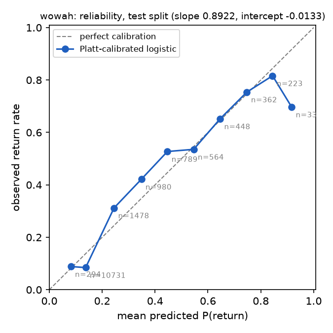
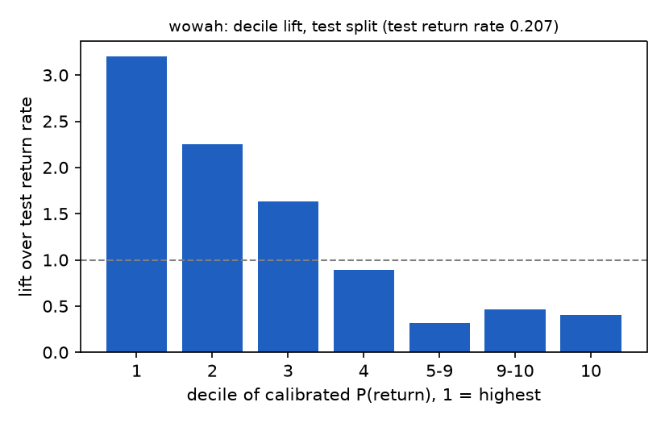

# Results: day-one return on WoWAH

Pengjun Lu, 2026-11-06. Every number below is read from `results/wowah/results.json`, produced by `./run.sh`. All cells are aggregates of at least 10 returning and 10 non-returning avatars.

## Population

|                                            |                                                                   |
| ------------------------------------------ | ----------------------------------------------------------------- |
| Snapshot rows parsed                       | 36,513,634 (1,082 days with data, 24 empty days inside the range) |
| New avatars (level ≤ 5 at first sighting) | 79,659                                                            |
| Excluded, next day not observed            | 162                                                               |
| Eligible                                   | 79,497                                                            |
| Returned on day 1                          | 21,399 (26.9%)                                                    |

Return rate by cohort year: 2006 29.4% (21,847), 2007 27.5% (34,714), 2008 23.8% (22,539), 2009 20.9% (397). The return rate changes over time, so the three parts of the time-ordered split have different base rates: 27.7% in train, 30.9% in validation, 20.7% in test.

Temporal split by whole cohort date, 60% / 80% of rows:

| Part       | Cohort dates                        |   Rows | Return rate |
| ---------- | ----------------------------------- | -----: | ----------: |
| train      | 2006-01-01 to 2007-08-21, 583 dates | 47,655 |       27.7% |
| validation | 2007-08-22 to 2008-06-02, 273 dates | 15,940 |       30.9% |
| test       | 2008-06-03 to 2009-01-09, 216 dates | 15,902 |       20.7% |

Test return rate, which is the PR-AUC floor: 0.2071.

## Models, test split

| Model                                 |              PR-AUC | ROC-AUC |  Brier |
| ------------------------------------- | ------------------: | ------: | -----: |
| Majority class (everyone churns)      |      0.2071 (floor) |   0.500 | 0.1691 |
| Session minutes, single feature       | 0.5264, 2.54x floor |   0.771 | 0.1310 |
| Logistic regression, L2               | 0.5578, 2.69x floor |   0.803 | 0.1245 |
| Logistic regression, Platt-calibrated | 0.5578, 2.69x floor |   0.803 | 0.1252 |

## Calibration

Platt slope 0.892, intercept −0.013, fit on validation. Brier moves from 0.1245 to 0.1252, so calibration fit on validation made test slightly worse. The mean prediction on test is 0.212 before Platt and 0.229 after it, against an observed rate of 0.207. The likely explanation is that Platt learned the scale of a high-return window (validation set) and applied it to a low-return one (test set).

Each row groups test avatars by their calibrated predicted probability $\hat p$; *Mean predicted* is that group's average $\hat p$ and *Observed* is the fraction that actually returned.

| Bin     | Players | Mean predicted | Observed |
| ------- | ------: | -------------: | -------: |
| 0.0-0.1 |     294 |          0.082 |    0.088 |
| 0.1-0.2 |  10,731 |          0.138 |    0.084 |
| 0.2-0.3 |   1,478 |          0.245 |    0.312 |
| 0.3-0.4 |     980 |          0.348 |    0.421 |
| 0.4-0.5 |     789 |          0.447 |    0.527 |
| 0.5-0.6 |     564 |          0.546 |    0.536 |
| 0.6-0.7 |     448 |          0.646 |    0.652 |
| 0.7-0.8 |     362 |          0.747 |    0.754 |
| 0.8-0.9 |     223 |          0.844 |    0.816 |
| 0.9-1.0 |      33 |          0.917 |    0.697 |

## Threshold

Threshold chosen on validation to maximize F1: 0.237.

On test: precision 0.516, recall 0.663, F1 0.580; TP 2,184, FP 2,053, FN 1,110, TN 10,555.

## Decile lift

Test avatars are ranked by $\hat p$ and split into ten equal groups, decile 1 holding the highest scores; *Return rate* is the fraction of each group that actually returned, and *Lift* is that rate divided by the test split return rate of 0.207.

| Deciles | Players | Return rate | Lift |
| ------- | ------: | ----------: | ---: |
| 1       |   1,590 |       0.664 | 3.20 |
| 2       |   1,590 |       0.467 | 2.25 |
| 3       |   1,590 |       0.339 | 1.64 |
| 4       |   1,590 |       0.184 | 0.89 |
| 5-9     |   7,442 |       0.065 | 0.31 |
| 9-10    |     511 |       0.096 | 0.46 |
| 10      |   1,589 |       0.084 | 0.40 |

Deciles 5 to 9 collapse into one group because 6,980 of its 7,442 test avatars share one score: one session, one snapshot, ten minutes, no level gained, one zone. Tied scores stay in one group by rule.

## Coefficients and a caveat

The L2 model scores avatar $i$ as $z_i = w \cdot x_i + b$:

| Term               | What it is                                                                                                                                                  |
| ------------------ | ----------------------------------------------------------------------------------------------------------------------------------------------------------- |
| Input $x_i$      | Avatar $i$'s five standardized feature values: `sessions`, `session_minutes`, `snapshots`, `levels_gained`, `zones`; different for every avatar |
| Coefficients $w$ | Five weights learned on train; shared by all avatars                                                                                                        |
| Intercept $b$    | Starting score learned on train; shared by all avatars                                                                                                      |

Fitted values: sessions 0.18, session_minutes −2.70, snapshots 3.13, levels_gained 0.61, zones −0.10; $b = -1.16$.

`session_minutes` and `snapshots` are near-duplicates (correlation 0.992 after the transform) and take large opposite signs, so neither coefficient can be read alone. One thing their difference can carry is being online at the end of the day, because minutes are cut at midnight while the last snapshot still counts.

The section below shows how much that matters. Refitting without `snapshots` gives clean coefficients, levels_gained 0.70, session_minutes 0.26, sessions 0.24, zones 0.00, at PR-AUC 0.547 and ROC-AUC 0.783.

The five-feature model is reported because it is the one written down before the run. A future pre-registration should drop `snapshots`.

## Leakage and sensitivity

| Run                     | Change                                                                    | Eligible avatars | Actual Return rate | PR-AUC | Floor | PR-AUC / floor | ROC-AUC |
| ----------------------- | ------------------------------------------------------------------------- | ---------------: | ------------------: | -----: | ----: | -------------: | ------: |
| Main                    | None; temporal split by cohort date                                       |           79,497 |               0.269 |  0.558 | 0.207 |           2.69 |   0.803 |
| Random split            | Assign avatars to train, validation and test at random instead of by date |           79,497 |               0.269 |  0.593 | 0.270 |           2.20 |   0.790 |
| Level 1 only            | Count an avatar as new only if it is level 1 at first sighting            |           59,542 |               0.244 |  0.524 | 0.174 |           3.02 |   0.796 |
| Drop < 72 of 144        | Drop cohorts whose next day has fewer than half of its 144 samples        |           77,464 |               0.271 |  0.569 | 0.213 |           2.67 |   0.806 |
| Strict return           | Count a return only if a session starts on the next day                   |           79,497 |               0.244 |  0.515 | 0.188 |           2.74 |   0.797 |
| Drop online at midnight | Drop avatars online in the last 10 minutes of the cohort day              |           72,136 |               0.205 |  0.458 | 0.161 |           2.84 |   0.779 |
| Without `snapshots`   | Remove `snapshots`, a near-duplicate of session minutes                 |           79,497 |               0.269 |  0.547 | 0.207 |           2.64 |   0.783 |

- Random split is not better relative to its floor compared to Main.
- **Avatars online at midnight inflate the absolute numbers.** 9.3% of eligible avatars were online in the last 10 minutes of their cohort day. They return at 89.9% against 20.5% for the rest, largely because a session still running at midnight makes the next day active by definition. In the test window these avatars are 6.3% of all avatars, but 28.6% of the model's top-scoring decile. The top decile's 66.4% return rate is therefore partly a product of this mechanism, not only of avatars choosing to come back. This information is available at the scoring instant, so it is not leakage, but it is not a prediction about a decision to come back. Dropping these avatars lowers PR-AUC to 0.458 and the return rate to 20.5%, while the multiple of the floor stays at 2.84.
- **The result does not depend on the new-avatar rule.** Counting only avatars at level 1 on first sighting removes a quarter of eligible avatars and raises PR-AUC / floor from 2.69 to 3.02.

## Limitations

The unit is an avatar on one Horde realm, not a person. The clock is the collector's local time. Sessions are inferred from 10-minute samples. The trace is from 2006 to 2009. Death Knights are excluded by the level rule.
