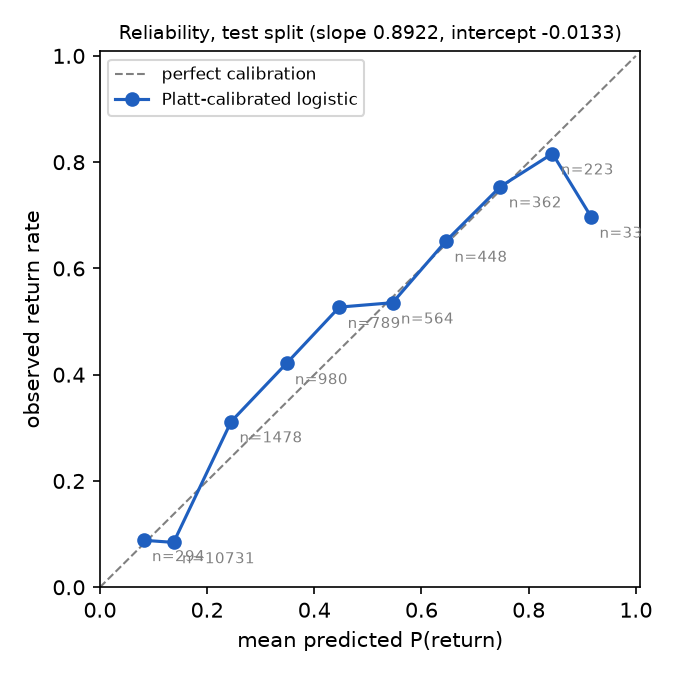
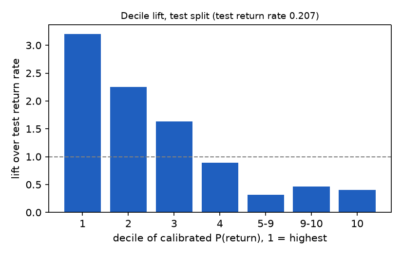

# Results: day-one return on WoWAH

Pengjun Lu, 2026-11-06. Every number below is read from `results/wowah/results.json`, produced by `./run.sh` on the archive whose SHA-256 is recorded in `download.py`. All cells are aggregates of at least 10 returning and 10 non-returning avatars.

## Population

| | |
| --- | --- |
| Snapshot rows parsed | 36,513,634 (1,082 days with data, 24 empty days inside the range) |
| New avatars (level ≤ 5 at first sighting) | 79,659 |
| Excluded, right-censored | 3 |
| Excluded, next day empty | 159 |
| Eligible | 79,497 |
| Returned on day 1 | 21,399 (26.9%) |

Return rate by cohort year: 2006 29.4% (21,847), 2007 27.5% (34,714), 2008 23.8% (22,539), 2009 20.9% (397). The rate is not stable over the trace, which matters for the split below: 27.7% in train, 30.9% in validation, 20.7% in test.

Temporal split by whole cohort date, 60% / 80% of rows:

| Part | Cohort dates | Rows |
| --- | --- | ---: |
| train | 2006-01-01 to 2007-08-21, 583 dates | 47,655 |
| validation | 2007-08-22 to 2008-06-02, 273 dates | 15,940 |
| test | 2008-06-03 to 2009-01-09, 216 dates | 15,902 |

Test return rate, which is the PR-AUC floor: 0.2071.

## Models, test split

| Model | PR-AUC | ROC-AUC | Brier |
| --- | ---: | ---: | ---: |
| Majority class (everyone churns) | 0.2071 (floor) | 0.500 | 0.1691 |
| Session minutes, single feature | 0.5264 | 0.771 | 0.1310 |
| Logistic regression, L2 | 0.5578 | 0.803 | 0.1245 |
| Logistic regression, Platt-calibrated | 0.5578 | 0.803 | 0.1252 |

The logistic model reaches 2.7 times the floor. Session minutes alone reach 2.5 times; the other four features add 0.03 PR-AUC and 0.03 ROC-AUC. Majority-class accuracy is 0.793; the calibrated model at its threshold reaches 0.801.

## Calibration

Platt slope 0.892, intercept −0.013, fit on validation. Brier moves from 0.1245 to 0.1252, so calibration fit on validation made test slightly worse. The mean prediction on test is 0.212 before Platt and 0.229 after it, against an observed rate of 0.207. The validation window, which directly precedes test, has a return rate of 30.9% against 20.7% in test. The likely explanation is that Platt learned the scale of a high-return window and applied it to a low-return one. This run does not prove that cause. The reliability table also shows the error is not a uniform shift: two thirds of the test rows sit in the 0.1 to 0.2 bin, where the model predicts 0.138 and observes 0.084, while the 0.2 to 0.5 bins observe more returns than predicted.

| Bin | Players | Mean predicted | Observed |
| --- | ---: | ---: | ---: |
| 0.0-0.1 | 294 | 0.082 | 0.088 |
| 0.1-0.2 | 10,731 | 0.138 | 0.084 |
| 0.2-0.3 | 1,478 | 0.245 | 0.312 |
| 0.3-0.4 | 980 | 0.348 | 0.421 |
| 0.4-0.5 | 789 | 0.447 | 0.527 |
| 0.5-0.6 | 564 | 0.546 | 0.536 |
| 0.6-0.7 | 448 | 0.646 | 0.652 |
| 0.7-0.8 | 362 | 0.747 | 0.754 |
| 0.8-0.9 | 223 | 0.844 | 0.816 |
| 0.9-1.0 | 33 | 0.917 | 0.697 |

## Threshold

Max-F1 cut on validation: 0.237. On test: precision 0.516, recall 0.663, F1 0.580; TP 2,184, FP 2,053, FN 1,110, TN 10,555.

## Decile lift

| Deciles | Players | Return rate | Lift |
| --- | ---: | ---: | ---: |
| 1 | 1,590 | 0.664 | 3.20 |
| 2 | 1,590 | 0.467 | 2.25 |
| 3 | 1,590 | 0.339 | 1.64 |
| 4 | 1,590 | 0.184 | 0.89 |
| 5-9 | 7,442 | 0.065 | 0.31 |
| 9-10 | 511 | 0.096 | 0.46 |
| 10 | 1,589 | 0.084 | 0.40 |

Deciles 5 to 9 collapse into one group because 6,980 of its 7,442 test avatars share one score: one session, one snapshot, ten minutes, no level gained, one zone. Tied scores stay in one group by rule.

## Coefficients and a caveat

Standardized coefficients of the L2 model: sessions 0.18, session_minutes −2.70, snapshots 3.13, levels_gained 0.61, zones −0.10, intercept −1.16.

`session_minutes` and `snapshots` are near-duplicates (correlation 0.992 after the transform) and take large opposite signs, so neither coefficient can be read alone. One thing their difference can carry is being online at the end of the day, because minutes are cut at midnight while the last snapshot still counts; the section below shows how much that matters. Refitting without `snapshots` gives clean coefficients, levels_gained 0.70, session_minutes 0.26, sessions 0.24, zones 0.00, at PR-AUC 0.547 and ROC-AUC 0.783. The five-feature model is reported because it is the one written down before the run; a future pre-registration should drop `snapshots`.

## Leakage and sensitivity

| Run | Eligible | Return rate | PR-AUC | Floor | PR-AUC / floor | ROC-AUC |
| --- | ---: | ---: | ---: | ---: | ---: | ---: |
| Main (temporal split) | 79,497 | 0.269 | 0.558 | 0.207 | 2.69 | 0.803 |
| Random split, same model | 79,497 | 0.269 | 0.593 | 0.270 | 2.20 | 0.790 |
| Level 1 at first sighting only | 59,542 | 0.244 | 0.524 | 0.174 | 3.02 | 0.796 |
| Drop cohorts whose next day has < 72 of 144 samples | 77,464 | 0.271 | 0.569 | 0.213 | 2.67 | 0.806 |
| Strict return: a session must *start* on day 1 | 79,497 | 0.244 | 0.515 | 0.188 | 2.74 | 0.797 |
| Drop avatars online in the last 10 minutes of the cohort day | 72,136 | 0.205 | 0.458 | 0.161 | 2.84 | 0.779 |
| Without the `snapshots` feature | 79,497 | 0.269 | 0.547 | 0.207 | 2.64 | 0.783 |

- **Random split is not better relative to its floor.** Its raw PR-AUC is higher because its floor is higher (0.270 against 0.207); relative to the floor it is lower, and ROC-AUC is lower. This check finds no sign of day-specific information helping the model. It cannot rule out every form of leakage.
- **Avatars online at midnight inflate the absolute numbers.** 9.3% of eligible avatars were online in the last 10 minutes of their cohort day. They return at 89.9% against 20.5% for the rest, largely because a session still running at midnight makes the next day active by definition. They are 28.6% of the top test decile against 6.3% of test overall, so the 66.4% top-decile return rate partly reflects this mechanism. This information is available at the scoring instant, so it is not leakage, but it is not a prediction about a decision to come back. Dropping these avatars lowers PR-AUC to 0.458 and the return rate to 20.5%, while the multiple of the floor stays at 2.84. The strict label gives the same picture at 2.74.
- **The new-avatar rule is not the result.** Level 1 only drops a quarter of the population and raises the lift over the floor.

## What this says about the method

On a public game trace, with a label constructed from behaviour and a split that never lets a later cohort inform an earlier one, first-day activity predicts next-day return at 2.7 times the no-skill floor, and at 2.8 times after removing avatars online at midnight. Session minutes alone carry most of that. Calibration did not transfer cleanly: Platt scaling fit on a validation window with a 30.9% return rate slightly hurt on a test window with 20.7%. A benchmark that reports calibration should report the return rate of each split beside it, and calibration should be refit on recent cohorts.

## Limitations

The unit is an avatar on one Horde realm, not a person. The clock is the collector's local time. Sessions are inferred from 10-minute samples. The trace is from 2006 to 2009. Death Knights are excluded by the level rule.
